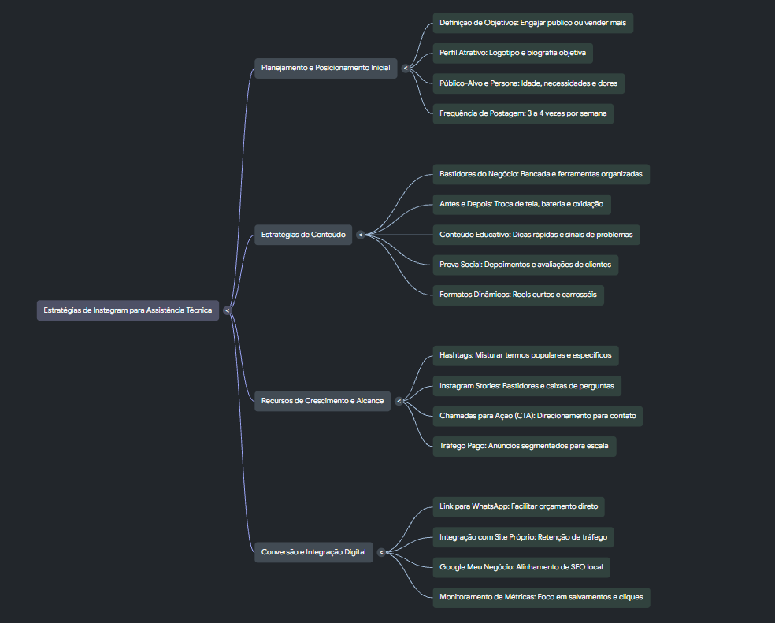

# meu-segundo-cerebro-psatech

## Tema e objetivo
O tema e objetivo do meu NotebookLM é referente a uma loja que estou criando no istagram mas não teve nenhum acesso ainda, nenhuma projeto fechado, estarei utilizando esse repositório para aprender no BootCamp da DXC na Dio.

## Fontes utilizadas

| # | Fonte | Tipo | Por que confio nela |
|---|-------|------|---------------------|
https://onlineos.com.br/10-dicas-para-atrair-clientes-para-sua-assistencia-tecnica/ - TIPO BLOG - Confio nessa fonte pois as dicas são realmente boas.
https://www.locaweb.com.br/blog/temas/marketing-e-seo/como-crescer-no-instagram/ - TIPO BLOG - Confio nessa fonte pois a Locaweb é uma empresa confiavel.
https://h2web.com.br/impulsione-sua-assistencia-tecnica-no-instagram-estrategias-comprovadas/ - TIPO BLOG - Confio nessa fonte foi é bem legivel.

## Diretriz de comportamento do notebook
Esta foi a instrução que dei ao notebook:

Quero estudar sobre métodos que eu possa utilizar para que meu perfil no instagram, o perfil de uma loja de manutenção de computadores e notebooks tenha mais visibilidade, a loja ainda não teve nenhum atendimento, tem 135 seguidores e segue 430 pessoas.
## Perguntas e respostas

### Pergunta 1: Com base nas fontes, qual o orçamento inicial eu devo ter.
**Resposta do notebook: ### Fase Inicial: Orçamento de R$ 0 em Tráfego (Foco no Orgânico)

* **Vitrine Digital Gratuita:** O Instagram permite construir autoridade e atrair clientes sem a necessidade de gastar dinheiro com anúncios logo no início[1].
* **Sem Necessidade de Agência:** Não há necessidade de contratar agências ou investir em equipamentos complexos de filmagem; o segredo é utilizar o celular para registrar o trabalho que já ocorre na sua bancada[2][3].
* **Produção de Prova Técnica:** O investimento principal nesta etapa é o seu tempo para produzir conteúdos de "Antes e Depois", bastidores de manutenção e testes de diagnóstico

Fontes citadas:
https://www.locaweb.com.br/blog/temas/marketing-e-seo/como-crescer-no-instagram/
[Print do chat com citações](prints/printDio1.png)

### Pergunta 2: Quanto posso chegar a faturar no mês
**Resposta do notebook: As fontes **não estabelecem um valor único ou garantido de faturamento mensal**, pois os ganhos dependem da capacidade operacional, do volume de atendimentos e da organização do negócio[1][2].

No entanto, em diagnósticos de mercado voltados para empresas de assistência técnica, as **faixas de faturamento mensal habituais do setor** são divididas nos seguintes patamares[3]:

* **Até R$ 20.000 / mês**: Faixa comum para negócios em fase inicial, operações menores ou técnicos atuando individualmente[3].
* **R$ 20.000 a R$ 30.000 / mês**: Patamar atingido à medida que a presença local se consolida e o fluxo de atendimentos se torna constante[3].
* **R$ 30.000 a R$ 100.000 / mês**: Faixa de assistências com volume elevado de ordens de serviço e boa retenção de clientes[3].
* **Acima de R$ 100.000 / mês**: Operações estruturadas, com equipes técnicas e alta demanda regional[3].

* Fontes citadas:
https://reparodigital.net/gestao-de-redes-sociais-para-assistencia-tecnica/
[Print do chat com citações](prints/printDio2.png)

## Materiais gerados
- 🧠 [Mapa mental (PNG)](materiais/mapa-mental.png)
- 📊 [Slides (PDF)](materiais/slides.pdf)

## Link do notebook
🔗 [Acesse o notebook compartilhado]([cole aqui o link])
